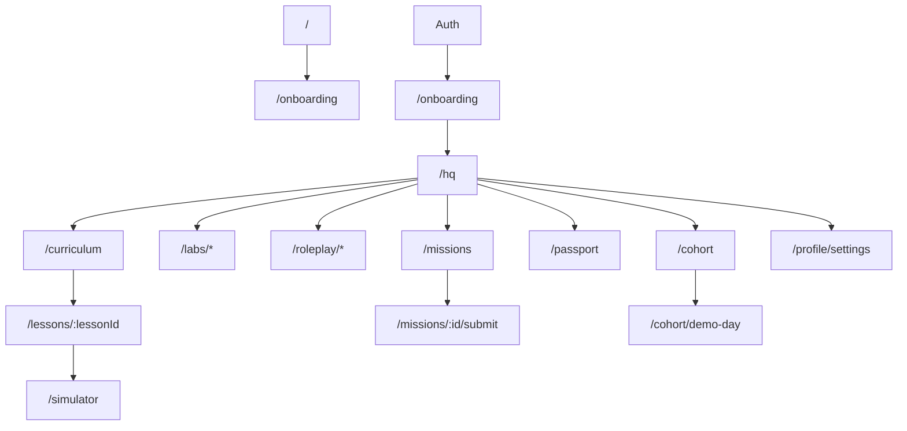

# Screens, Routes, and Wireframes

## Route inventory

| Route | Purpose | Primary action | Empty/loading/error state |
|---|---|---|---|
| `/` | Public promise and playable preview | Run first decision | Preview skeleton; retry if simulator fails |
| `/signup` | Legacy redirect to open learning | Start learning | Redirects to `/hq` |
| `/onboarding` | Name, venture idea, and skill check | Start learning | Local progress save; validation message |
| `/hq` | Venture HQ dashboard | Start next action | New venture checklist; state load skeleton; retry |
| `/curriculum` | Nine-module map | Open module | Locked explanation; progress skeleton |
| `/lessons/[lessonId]` | Six-step lesson player | Commit decision / continue | Resume last step; recover transition |
| `/simulator` | Living company and history | Run decision or What if | Starting-state explanation; event retry |
| `/labs/pricing` | Price and margin exploration | Apply price hypothesis | Example dataset; invalid-input message |
| `/labs/break-even` | Break-even modelling | Save model | Zero-margin warning |
| `/labs/persona` | Segment and evidence | Save persona | Empty evidence checklist |
| `/labs/canvas` | Business model map | Detect weak spot | Empty blocks with guidance |
| `/labs/funnel` | Funnel diagnosis | Save experiment | Missing-stage prompt |
| `/roleplay/customer` | Customer interview practice | Ask question | Select persona; AI unavailable fallback |
| `/roleplay/investor` | Pitch rehearsal | Start rehearsal | Passport completeness warning |
| `/roleplay/mentor` | Socratic help | Ask mentor | Context selection |
| `/missions` | Current and past missions | Open mission | Module mission explanation |
| `/missions/[missionId]` | Instructions and rubric | Start mission | Save draft |
| `/missions/[missionId]/submit` | Proof upload and declaration | Submit proof | Upload progress, type/size error |
| `/passport` | Portfolio/business plan | Export Passport | Completeness checklist; export retry |
| `/cohort` | Private group room | Request review | Invite/join state; moderation error |
| `/cohort/demo-day` | Demo Day schedule and submission | Rehearse or submit | Upcoming event state |
| `/profile/settings` | Consent, reminders, privacy | Save settings | Auth error; deletion confirmation |
| `/help` | Glossary, recovery, support | Contact facilitator | Offline contact message |

## Shared layout

Desktop uses a fixed left navigation rail (Venture HQ, Curriculum, Simulator, Labs, Roleplay, Missions, Passport, Cohort) and a top bar with cash, runway, review due, and profile. Mobile uses a bottom navigation with five primary destinations and a “More” sheet. The content column is max 1200px; lesson content is max 760px for readability.

## Dashboard wireframe

```text
+----------------------------------------------------------------+
| VentureCraft | CASH ₹9.1L | RUNWAY 9.4m | REVIEWS 2 | Profile  |
+---------+------------------------------------------------------+
| HQ      | GOOD MORNING, ANANYA        [Continue lesson]          |
| Learn   | +----------------+ +----------------+ +----------------+ |
| Sim     | | Cash ₹9.1L     | | Customers 4    | | Morale 74      | |
| Labs    | | ▼ this month   | | ▲ +4          | | ▲ +4           | |
| Missions| +----------------+ +----------------+ +----------------+ |
| Passport| TODAY'S MISSION: Interview 5 hostel residents          |
| Cohort  | [Start]  20 min      Proof: not started                  |
|         | SKILL MAP   1 Finding ● 2 Customer ○ 3 Validate 🔒 ... |
|         | NEXT REVIEW: Problem vs solution [Review now]           |
+---------+------------------------------------------------------+
```

## Lesson Player wireframe

```text
+----------------------------------------------------------------+
| Module 1 / Lesson 1     Challenge ● Decide ○ Consequence ○ ... |
+----------------------------------------------------------------+
|  THE LAST LAUNDRY PICKUP                                      |
|  Three residents report late pickups. You have ₹10,00,000.    |
|  What is your first move?                         00:28        |
|  [A Build app] [B Interview five] [C Poll group] [D Sell now] |
|                                                    [Commit]    |
|  AI Mentor (optional): [Ask a question]                        |
+----------------------------------------------------------------+
```

## Simulator wireframe

```text
+----------------------------------------------------------------+
| LIVE COMPANY       [Mainline] [What if] [History]              |
| Cash ₹8.2L | Runway 9.1m | Customers 4 | Churn 5% | Morale 77 |
+----------------------+-----------------------------------------+
| Customers            | MONTH 2 CONSEQUENCE                     |
| ●●●●                 | Revenue       ₹2,000                   |
| Budget 2             | Cash          ₹8,16,334                |
| Reliable 1           | Evidence      31/100                   |
| Explorer 1           | “Paid pilot gave stronger evidence.”   |
+----------------------+ [Next decision] [Rewind]                |
| Cash / customers / runway chart (last 6 months)                |
+----------------------------------------------------------------+
```

## Pricing Lab wireframe

```text
+----------------------------------------------------------------+
| PRICING LAB                         [Reset] [Apply to venture]  |
| Segment [Reliability seeker v]  Price ₹[700 slider]            |
| Variable cost ₹[120]   Target customers [20]                   |
|                                                                |
| Contribution/customer ₹580   Break-even 148 customers          |
| Expected conversion 3.5%     Runway 7.9 months                 |
| [price-volume curve]        [margin waterfall]                 |
| AHA: ₹500 converts more, but ₹700 funds the next test sooner.  |
+----------------------------------------------------------------+
```

## AI Investor Arena wireframe

```text
+----------------------------------------------------------------+
| INVESTOR ARENA                 Evidence coverage 68%   03:00   |
| [Your pitch transcript / recording]                            |
| INVESTOR: Cautious seed investor                               |
| “How many users paid, and what did they do twice?”             |
| [Type answer...]                                  [Send]       |
| SCORE (after session): Problem 78 | Traction 54 | Ask 70       |
| Evidence cited | Unknowns | Next rehearsal                     |
+----------------------------------------------------------------+
```

## Mission Submission wireframe

```text
+----------------------------------------------------------------+
| MISSION 1: FIVE CUSTOMER CONVERSATIONS                         |
| Goal | Instructions | Valid proof | Rubric                    |
| [Participant criteria] [Quotes] [Frequency] [Problem statement]|
| Upload notes [Choose files]  0/5 conversations                 |
| I removed names and have permission to submit this evidence.  |
| [Save draft]                                      [Submit]     |
+----------------------------------------------------------------+
```

## Venture Passport wireframe

```text
+----------------------------------------------------------------+
| VENTURE PASSPORT                              [Export PDF]      |
| 8/12 required evidence items     Completeness 67%              |
| Problem ● Customer ● Validation ● MVP ○ Pricing ●              |
| Growth ○ Team ○ Funding ○ Scale ○                              |
| +--------------------+ +-------------------------------------+ |
| | Problem statement  | | Evidence: 5 interviews, 3 quotes   | |
| | [Edit] [View source]| | Last updated 12 Nov                  | |
| +--------------------+ +-------------------------------------+ |
| Missing next: MVP result [Open mission]                        |
+----------------------------------------------------------------+
```

## Sitemap



