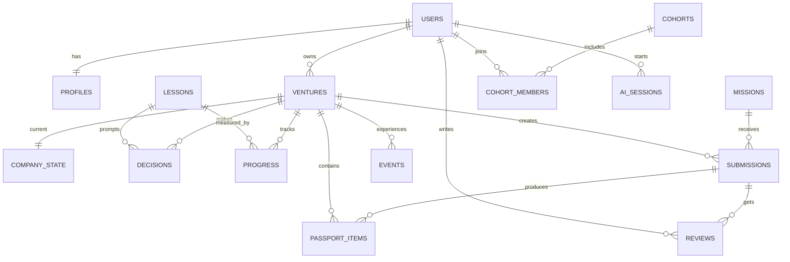

# Supabase/Postgres Data Model

## Conventions

All tables use UUID primary keys, `created_at timestamptz not null default now()`, and `updated_at timestamptz not null default now()` where mutable. User-owned rows include `user_id` or reach the user through `venture_id`. Row Level Security is enabled on every user-owned table. Money is stored as integer paise (`bigint`) in production; UI formats it as rupees.

## Tables

### `users`

Managed by Supabase Auth: `id uuid`, `email text`, `created_at`, `last_sign_in_at`. Application tables reference `auth.users.id`; do not duplicate passwords.

### `profiles`

`id uuid PK/FK users.id`, `display_name text`, `age_band text`, `city text nullable`, `learning_language text default 'en-IN'`, `weekly_goal smallint`, `reminder_day smallint`, `streak_days int default 0`, `streak_paused_until date nullable`, `consent_ai_at timestamptz nullable`, `created_at`, `updated_at`.

### `ventures`

`id uuid PK`, `user_id uuid FK`, `name text`, `idea text`, `context text`, `status text` (`active|completed|archived`), `seed bigint`, `current_module smallint`, `current_lesson text nullable`, `created_at`, `updated_at`.

### `company_state`

`venture_id uuid PK/FK`, `cash_paise bigint`, `monthly_burn_paise bigint`, `runway_months numeric(5,2)`, `customers int`, `leads int`, `churn_rate numeric(5,2)`, `conversion_rate numeric(5,2)`, `average_price_paise bigint`, `variable_cost_paise bigint`, `revenue_paise bigint`, `morale smallint`, `quality smallint`, `evidence_quality smallint`, `awareness smallint`, `retention_rate numeric(5,2)`, `valuation_paise bigint`, `months_elapsed smallint`, `weak_spot text`, `updated_at`.

### `decisions`

`id uuid PK`, `venture_id uuid FK`, `lesson_id uuid nullable FK`, `branch_id uuid nullable`, `month_index smallint`, `option_key text`, `effects jsonb`, `state_before jsonb`, `state_after jsonb`, `event_key text nullable`, `is_committed boolean`, `created_at`.

### `lessons`

`id text PK`, `module_number smallint`, `title text`, `order_index smallint`, `challenge jsonb`, `options jsonb`, `insight jsonb`, `retry jsonb`, `mission_id uuid nullable`, `retrieval_items jsonb`, `published_at timestamptz`, `version int`.

### `progress`

`id uuid PK`, `venture_id uuid FK`, `lesson_id text FK`, `status text`, `challenge_completed_at`, `decision_at`, `retry_at`, `retrieval_score smallint`, `completed_at`, `best_decision jsonb`, `review_due_at date`, `review_interval_days smallint`, `created_at`, `updated_at`.

### `missions`

`id uuid PK`, `module_number smallint`, `title text`, `instructions text`, `proof_schema jsonb`, `rubric jsonb`, `validity_rules jsonb`, `estimated_minutes smallint`, `published_at`.

### `submissions`

`id uuid PK`, `mission_id uuid FK`, `venture_id uuid FK`, `user_id uuid FK`, `status text` (`draft|submitted|needs_changes|accepted|rejected`), `answers jsonb`, `proof_file_ids uuid[]`, `consent_confirmed boolean`, `score smallint nullable`, `feedback text nullable`, `reviewer_id uuid nullable`, `submitted_at`, `reviewed_at`, `created_at`, `updated_at`.

### `passport_items`

`id uuid PK`, `venture_id uuid FK`, `item_type text`, `title text`, `content jsonb`, `source_submission_id uuid nullable FK`, `source_date date nullable`, `evidence_status text`, `sort_order smallint`, `created_at`, `updated_at`.

### `cohorts`

`id uuid PK`, `name text`, `facilitator_id uuid FK users.id`, `start_date date`, `end_date date`, `status text`, `created_at`.

### `cohort_members`

`cohort_id uuid FK`, `user_id uuid FK`, `role text`, `leaderboard_opt_in boolean default false`, `joined_at`, primary key `(cohort_id, user_id)`.

### `reviews`

`id uuid PK`, `submission_id uuid FK`, `reviewer_id uuid FK`, `reviewee_id uuid FK`, `rubric_scores jsonb`, `feedback text`, `status text`, `created_at`, `updated_at`.

### `events`

`id uuid PK`, `venture_id uuid FK`, `month_index smallint`, `event_key text`, `probability numeric(5,2)`, `trigger_snapshot jsonb`, `effects jsonb`, `response text nullable`, `created_at`.

### Supporting tables

- `file_objects`: `id`, `user_id`, `venture_id`, `storage_path`, `mime_type`, `size_bytes`, `sha256`, `status`, `created_at`.
- `ai_sessions`: `id`, `user_id`, `venture_id`, `role`, `scenario`, `prompt_version`, `transcript jsonb`, `score jsonb`, `retention_until`, `created_at`.
- `analytics_events`: `id`, `user_id`, `venture_id`, `event_name`, `properties jsonb`, `occurred_at`.

## Relations

## Integrity and security

- A user can read/write only ventures they own; cohort rows require membership; facilitator writes require cohort role.
- A `submission` cannot become `accepted` without a reviewer or a recorded automated rubric version.
- A committed decision is immutable; corrections append a new audit event.
- Storage policies allow access only through the owning venture and signed URLs.
- Delete-account flow deletes or anonymises AI transcripts, proof files, analytics, and profile data according to the retention policy.

